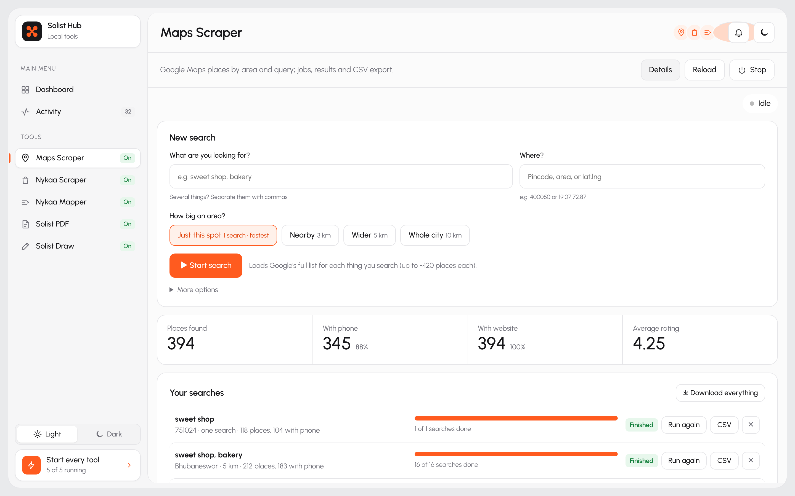
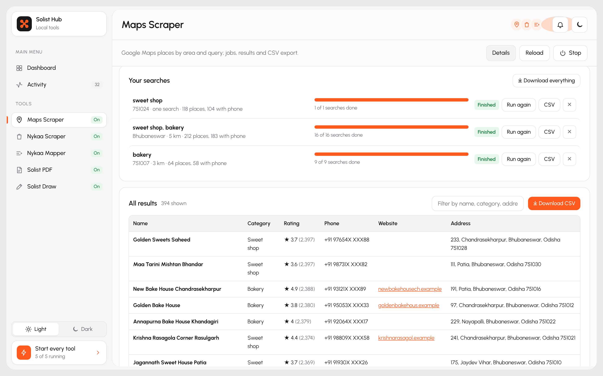
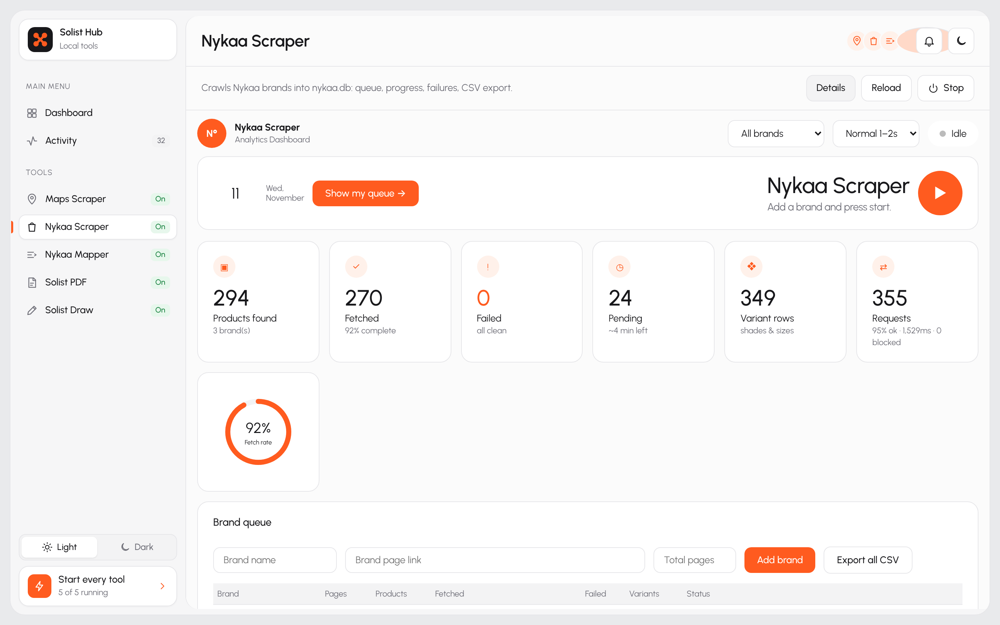
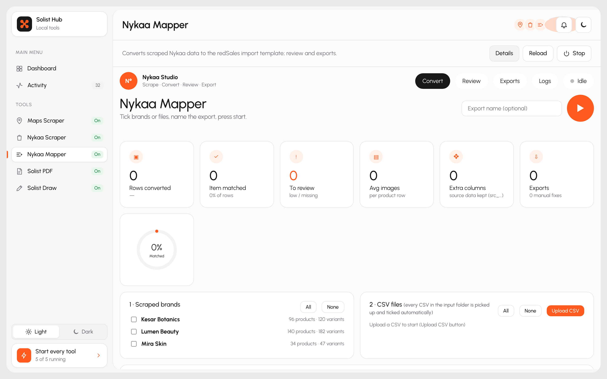
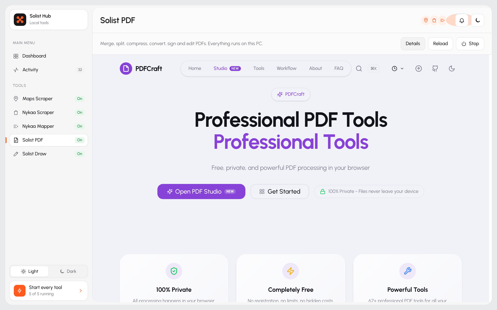
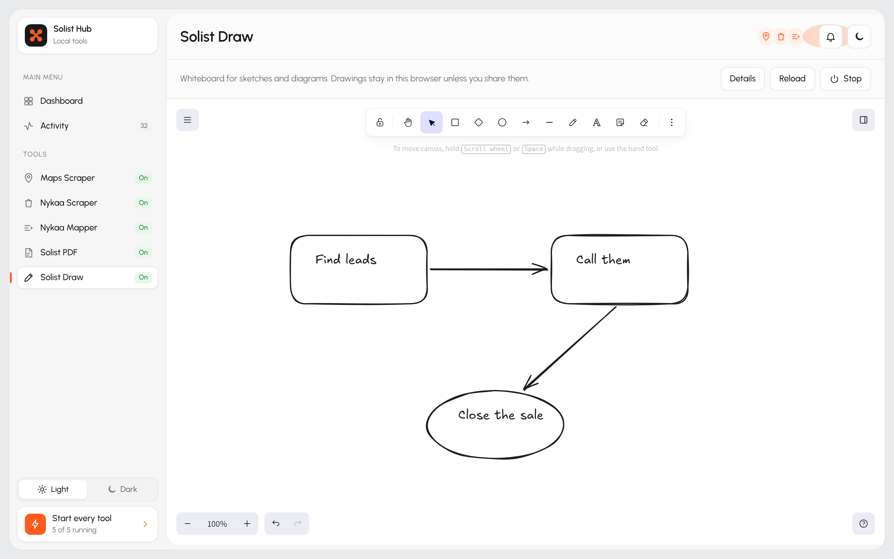

<div align="center">

# Solist Hub

### Find leads on Google Maps, scrape product catalogues, edit PDFs and sketch ideas. Free, on your own computer, from one dashboard.

[](#setup-guide)
[](#setup-guide)
[](#setup-guide)
[](https://www.python.org/downloads/)
[](https://nodejs.org)
[](https://github.com/Solo-Solist/solist-hub/stargazers)

**No cloud. No sign-up. No API keys. No monthly bill.**

[Quick start](#quick-start) · [The tools](#the-tools) · [Setup guide](#setup-guide) · [Self-test](#check-that-everything-works)


<sub>Screenshots use sample data. Business names are invented and phone numbers are masked.</sub>

</div>

## Why Solist Hub?

Lead lists, product data and PDF tools usually mean paying for several online services and uploading your data
to each one. Solist Hub puts five of these tools on your own computer, behind one dashboard you start with a
double-click.

- 📍 **Get the whole list.** The Maps Scraper scrolls Google's results to the end, so you get up to about 120 places per search instead of the first 20, with phone, address, rating and website.
- 🛍️ **A catalogue in minutes.** Paste a Nykaa brand link to collect every product, shade and size. Then turn it into a ready-to-import file with category, HSN code and GST rate filled in.
- 📄 **60+ PDF tools, offline.** Merge, split, compress, convert, OCR and sign PDFs without uploading anything.
- ✏️ **A whiteboard built in.** Sketch flows and diagrams, then export them as PNG or SVG.
- 🔒 **Private by design.** Everything runs on `localhost`. Your data never leaves your machine unless you choose to share the Hub.
- 🖥️ **One window for all of it.** Start or stop any tool, watch its live log, and see if anything crashed.

## Quick start

```bash
git clone https://github.com/Solo-Solist/solist-hub.git
cd solist-hub
./setup.sh && ./launch.sh      # Windows: double-click setup.bat, then launch.bat
```

The Hub opens at <http://localhost:9000>. You need Python 3.11+ and Node.js 20+ ([details](#setup-guide)).

**If Solist Hub saves you time, please ⭐ star the repo.** It helps other people find it.

## What you can do with it

| You want to… | Use |
|---|---|
| Build a call list of sweet shops, bakeries, salons or any other business in an area, with phone, address, rating and website | **Maps Scraper** |
| Collect a brand's full product range from Nykaa: prices, shades, sizes, ratings, ingredients and images | **Nykaa Scraper** |
| Turn that catalogue into a ready-to-import product file, with category, HSN code and GST rate filled in | **Nykaa Mapper** |
| Merge, split, compress, convert, sign or edit PDFs without uploading them anywhere | **Solist PDF** |
| Sketch a process, a floor plan or a diagram and export it as PNG or SVG | **Solist Draw** |
| See at a glance which tools are on, what they found and whether anything failed | **Solist Hub** |

A typical day: search Maps for "sweet shop" in a pincode, download the CSV and hand it to your callers.
Scrape a new brand from Nykaa, convert it with the Mapper, review the few rows it flags and import the file.

## The tools

### Solist Hub (the dashboard)

One window for everything, at <http://localhost:9000>.

- **Sidebar** listing every tool and whether it is on, starting or still needs setup.
- **Key numbers:** tools running, tools ready, PDF tools and places found.
- **Health and activity:** a health gauge, events per tool, a status heatmap and a list of recent events, including any crash.
- **Tool pages** with one-click setup, quick actions, a live log and the tool itself, opened inside the Hub.
- **Light and dark** themes, a phone layout, and **Start all** and **Stop all** buttons. Closing the Hub stops every tool.

| Dark theme | Phone |
|---|---|
|  |  |

### Maps Scraper

Finds businesses on Google Maps by what they do and where they are.

- Type what you are looking for (several things, separated by commas) and a pincode, area or `lat,lng`.
- Pick an area size: **Just this spot** (one search) or **Nearby**, **Wider** or **Whole city**, which cover 3, 5 or 10 km with a grid of searches.
- It scrolls Google's results list to the end, so each search gets the full list of up to about 120 places, not just the first 20.
- It opens 1 to 3 place pages at once (the **Speed** setting) and saves name, category, rating, reviews, address, phone, website and location.
- Every search is saved as a job you can stop, resume or run again. Results can be filtered and downloaded as CSV.
- If Google changes its page and a field comes back empty for most places, the job ends with a warning.




### Nykaa Scraper

Collects a brand's catalogue from Nykaa into a local database.

- Paste a brand page link and press start. You can queue several brands.
- It reads each product and every variant: shade (with colour), size, MRP, offer price, discount, stock, rating, categories, description, ingredients and images.
- It shows progress, failures and request health, can retry what failed, and resumes where it stopped.
- Export one brand or everything as CSV.



### Nykaa Mapper

Turns scraped products into an import file in a fixed template (41 columns).

- Tick scraped brands or upload any products CSV, then press start.
- Each product is matched to a category, sub-category and item name from a 136-row taxonomy, which also gives its 8-digit HSN code and GST rate.
- Rows it is unsure about go to a **Review** tab, where you fix them once and the fix is remembered next time.
- Two files per export: one with the template columns only, and one that also keeps every scraped column.



### Solist PDF

More than 60 PDF tools that run in your browser: merge, split, compress, convert to and from Word, Excel and images,
OCR, sign, watermark, edit pages and more. Files never leave your computer.



### Solist Draw

A hand-drawn style whiteboard for quick diagrams, flows and sketches. Drawings are saved in your browser and can be
exported as PNG, SVG or a `.excalidraw` file.



## Setup guide

### 1. Install the prerequisites (once)

| | Windows | macOS | Ubuntu / Debian |
|---|---|---|---|
| **Python 3.11+** | `winget install -e --id Python.Python.3.12` | `brew install python` | `sudo apt install -y python3 python3-venv python3-pip` |
| **Node.js 20+** | `winget install -e --id OpenJS.NodeJS` | `brew install node` | [nodejs.org](https://nodejs.org) or `nvm install 20` |
| **Git** | `winget install -e --id Git.Git` | `xcode-select --install` | `sudo apt install -y git` |

Node.js is needed only to build Solist PDF and Solist Draw. Chrome or Edge is optional: with one installed, the
Hub opens in its own app window.

### 2. Download

```bash
git clone https://github.com/Solo-Solist/solist-hub.git
cd solist-hub
```

Or use **Code → Download ZIP** on GitHub and unzip it.

### 3. Set up

Each tool gets its own Python environment or Node packages inside its folder, so nothing is installed system-wide.

| OS | Command |
|---|---|
| Windows | double-click `setup.bat` |
| macOS / Linux | `./setup.sh` |

To set up only some tools, name their folders: `./setup.sh map_scrapper nykaa-scraper`. Solist PDF takes the
longest (several minutes) because it builds the whole site. You can also skip this step and use the setup button on a
tool's page in the Hub.

### 4. Launch

| OS | Command |
|---|---|
| Windows | double-click `launch.bat` |
| macOS | double-click `launch.command`, or run `./launch.sh` |
| Linux | `./launch.sh` |

The Hub opens at <http://localhost:9000>. Press the switch next to a tool to start it, or **Start all**.

| Tool | Folder | Address |
|---|---|---|
| Solist Hub | `hub/` | <http://localhost:9000> |
| Maps Scraper | `map_scrapper/` | <http://localhost:5000> |
| Nykaa Scraper | `nykaa-scraper/` | <http://localhost:8765> |
| Nykaa Mapper | `nykaa_mapper/` | <http://localhost:8766> |
| Solist PDF | `pdfcraft/` | <http://localhost:8090> |
| Solist Draw | `excalidraw/` | <http://localhost:8093> |

### Run one tool on its own

Every tool folder has its own `setup` and `start` scripts (`.sh` for macOS/Linux, `.bat` for Windows):

```bash
cd map_scrapper
./start.sh        # then open http://localhost:5000
```

### Update

```bash
git pull
./setup.sh        # Windows: setup.bat. Only needed when a tool's requirements changed.
```

## Check that everything works

Close the Hub, then run this from the project folder. It needs no internet and takes about two minutes.

```bash
python3 selftest.py        # Windows: python selftest.py
```

It starts the Hub without a window, checks that it refuses requests from other web pages, starts every tool that
is set up and opens its page, checks that a crashed tool is reported, then stops everything. Last, it runs the Maps
Scraper against a fake Google Maps with 124 places: the whole list must load, place pages must be read correctly,
and a job with several tabs must finish. Tools that are not set up yet are skipped, not failed. Each check prints
PASS or FAIL.

## Share the Hub with your team

`hub/share.sh` (Windows: `hub\share.bat`) puts the Hub online through [ngrok](https://ngrok.com), always behind a
username and password. The login is created on first run and kept in `hub/.share-credentials`, which never leaves
your computer. Press Ctrl+C to stop sharing.

## Your data

Databases, scraped results, exports, logs, `.env` files and installed packages stay on the machine that made them
and are never committed. A fresh download starts empty. To move your data to another computer, copy these files:

- `map_scrapper/gmaps.db`
- `nykaa-scraper/nykaa.db`
- `nykaa_mapper/studio.db`

The scrapers read public pages. Use them gently and follow the terms of the sites you collect from.

## Troubleshooting

- **A tool says "Setup did not finish"**: use the setup button on its page in the Hub, or run its `setup` script again.
- **"Port … is already in use"**: another program is using that port. Close it, or stop the copy of the tool that is already running.
- **Linux: the scraper's browser won't start**: `sudo map_scrapper/.venv-linux/bin/python -m playwright install-deps chromium`.
- **Maps job ends with "⚠ Google may have changed its page"**: Google changed its layout. The selectors in `map_scrapper/gmaps_scraper.py` (`parse_place`) need updating.
- **Something else**: run `python3 selftest.py`. The first FAIL line usually points at the problem.

## Credits

- **Solist Draw** (`excalidraw/`) is a fork of [Excalidraw](https://github.com/excalidraw/excalidraw), MIT licence.
- **Solist PDF** (`pdfcraft/`) is a fork of [PDFCraft](https://github.com/PDFCraftTool/pdfcraft), AGPL-3.0 licence.
- The scrapers use [Scrapling](https://github.com/D4Vinci/Scrapling) and [Playwright](https://playwright.dev).

Each forked folder keeps its own licence file, which applies to that folder. The rest of this project has no
licence: you are welcome to read it and run it, but all rights are reserved.

---

<div align="center">

Built by [Solo-Solist](https://github.com/Solo-Solist). Found a bug or have an idea? [Open an issue](https://github.com/Solo-Solist/solist-hub/issues).
If this project is useful to you, a ⭐ helps a lot.

</div>
