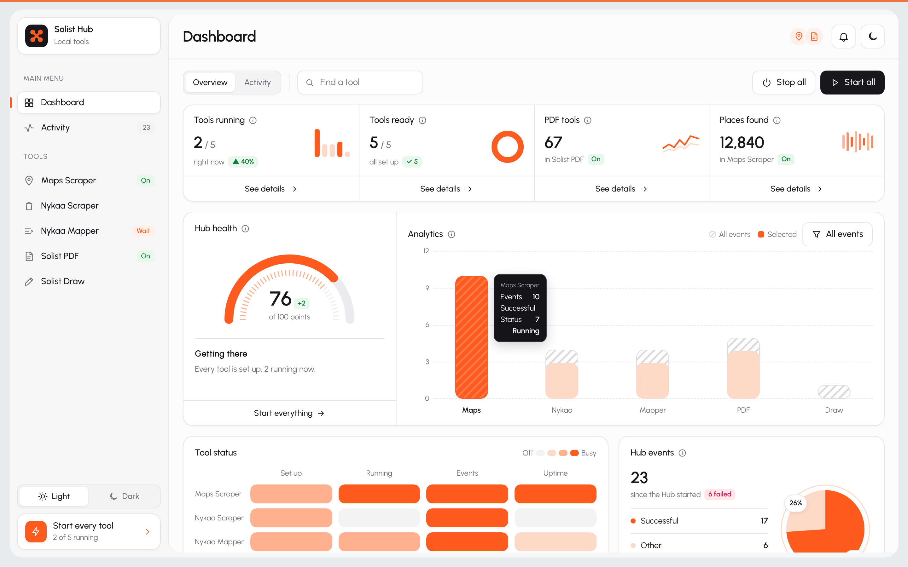
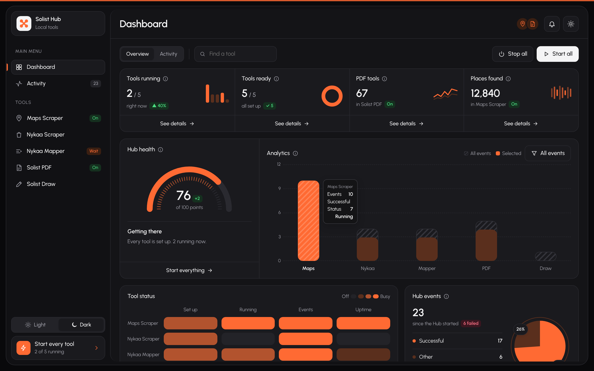
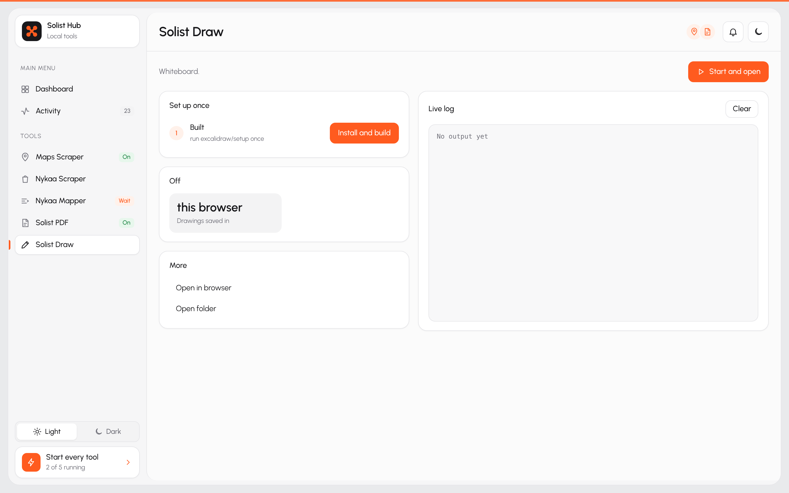
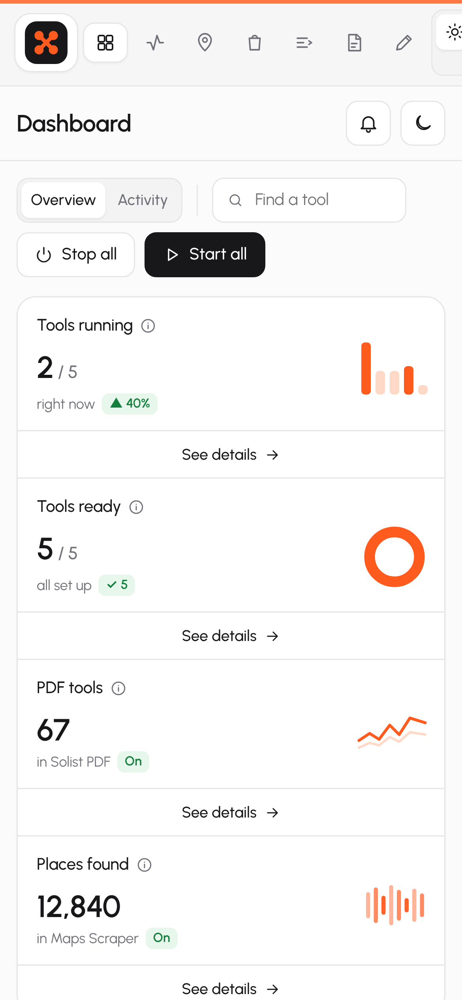

# Solist Project

A set of local tools with one dashboard to run them. **Solist Hub** starts and stops each tool, shows its
live log and opens its page in the same window. Everything runs on your own machine, on Windows, macOS or Linux.
Nothing is sent to a server.



## What the Hub shows

- **Sidebar** with every tool and whether it is on, starting or still needs setup.
- **KPI cards** for tools running, tools ready, PDF tools and places found.
- **Hub health** gauge, an **analytics** chart of events per tool, a **status heatmap** and an events breakdown.
- **Tool pages** with one-time setup steps, stats, quick actions and a live log. When a tool is running, its own page opens inside the Hub.
- **Light and dark** themes. The tools pick up the same look.

| Dark theme | Tool page | Phone |
|---|---|---|
|  |  |  |

## The tools

| Folder | Tool | Port | Needs |
|---|---|---|---|
| `hub/` | Solist Hub: one window to start and stop everything | 9000 | Python 3.8+ |
| `map_scrapper/` | Maps Scraper: Google Maps places, jobs and CSV export | 5000 | Python 3.10+ |
| `nykaa-scraper/` | Nykaa Scraper: crawls Nykaa brands into a local database | 8765 | Python 3.10+ |
| `nykaa_mapper/` | Nykaa Mapper: turns scraped data into the import template | 8766 | Python 3.11+ |
| `pdfcraft/` | Solist PDF: merge, split, compress, convert and sign PDFs | 8090 | Node.js 20+ to build, Python to serve |
| `excalidraw/` | Solist Draw: whiteboard for sketches and diagrams | 8093 | Node.js 18+ to build, Python to serve |

## 1. Install the prerequisites (once)

- **Python 3.11+**: [python.org](https://www.python.org/downloads/). Windows: `winget install -e --id Python.Python.3.12`. Ubuntu: `sudo apt install -y python3 python3-venv python3-pip`. macOS: `brew install python`.
- **Node.js 24+**: [nodejs.org](https://nodejs.org). Windows: `winget install -e --id OpenJS.NodeJS`. macOS: `brew install node`.
- **Git**: [git-scm.com](https://git-scm.com).
- Chrome or Edge is optional. With one installed, the Hub opens in its own app window.

## 2. Clone

```bash
git clone https://github.com/Solo-Solist/solist-project.git
cd solist-project
```

## 3. Set up

Each tool gets its own Python environment or Node packages inside its folder.

| OS | Command |
|---|---|
| Windows | double-click `setup.bat` |
| macOS / Linux | `./setup.sh` |

To set up only some tools, name them: `./setup.sh pdfcraft excalidraw`. Solist PDF takes the longest
because it builds the whole site.

## 4. Launch

| OS | Command |
|---|---|
| Windows | double-click `launch.bat` |
| macOS | double-click `launch.command`, or run `./launch.sh` |
| Linux | `./launch.sh` |

The Hub opens at <http://localhost:9000>. Press the switch next to a tool to start it. If a tool still
needs setup, its checklist has a button for that. Closing the Hub window stops every tool.

## Running one tool on its own

Every tool folder has its own `setup` and `start` scripts (`.sh` for macOS/Linux, `.bat` for Windows):

```bash
cd excalidraw
./start.sh        # then open http://localhost:8093
```

## What is not in the repo

Databases, scraped results, exports, invoices, logs, `.env` files and installed packages stay on the
machine that made them. A fresh clone starts empty. To move data between machines, copy those files
over yourself:

- `map_scrapper/gmaps.db`
- `nykaa-scraper/nykaa.db`
- `nykaa_mapper/studio.db`

## Troubleshooting

- **"port … is already in use"**: another program is using that port. Close it, or stop the copy of the tool that is already running.
- **Python environment missing**: run that tool's `setup` script again.
- **Linux, the scraper's browser won't start**: `sudo map_scrapper/.venv-linux/bin/python -m playwright install-deps chromium`.

`excalidraw` is Solist Draw, a fork of
[Excalidraw](https://github.com/excalidraw/excalidraw) at dd2f8fc3. `pdfcraft` is a
fork of PDFCraft. Each keeps its own license file.
